# Demo Analysis with 3D Player: User Guide

Demo Analysis scans a Team Fortress 2 demo for cheats, then lets you watch any detection in 3D without opening the game. This guide covers the main window, the 3D player and its controls, review mode, reports and clips.

**Contents**

1. [Getting started](#getting-started)
2. [The main window](#the-main-window)
3. [The 3D player at a glance](#the-3d-player-at-a-glance)
4. [Controls](#controls)
5. [Cameras](#cameras)
6. [The Show menu](#the-show-menu)
7. [Sound](#sound)
8. [Review mode](#review-mode)
9. [Players, reports and TF2BD](#players-reports-and-tf2bd)
10. [Saving clips](#saving-clips)
11. [Files, command line and troubleshooting](#files-command-line-and-troubleshooting)

## Getting started

A first scan takes four steps.

**What you need**

- Windows 10 or 11, 64-bit.
- Team Fortress 2 installed through Steam. The 3D player reads the maps, models and animations from your TF2 folder. TF2 never has to run, and nothing from the game is in the zip.
- A graphics card with OpenGL 3.3. Any PC that runs TF2 is fine.
- Optional: [ffmpeg](https://ffmpeg.org), to save clips as MP4 instead of GIF.

**Your first scan**

1. Unzip `Demo-Analysis-with-3D-Player.zip` anywhere and double-click `Demo Analysis.exe`. If Windows says it "protected your PC", click **More info**, then **Run anyway**. The program isn't signed, so Windows warns about it.
2. Drag a `.dem` file onto the window, or click **Open...**, pick a demo and click **Analyse**. TF2 keeps demos in `Team Fortress 2\tf\demos`.
3. Flagged players appear under the demo's name, with their number of detections. Click one to list their detections.
4. Click the **▶** button next to a detection. The 3D player opens 3 seconds before it, through that player's eyes.

## The main window

The main window picks which checks run, scans the demo and lists every flagged player with what each check found.

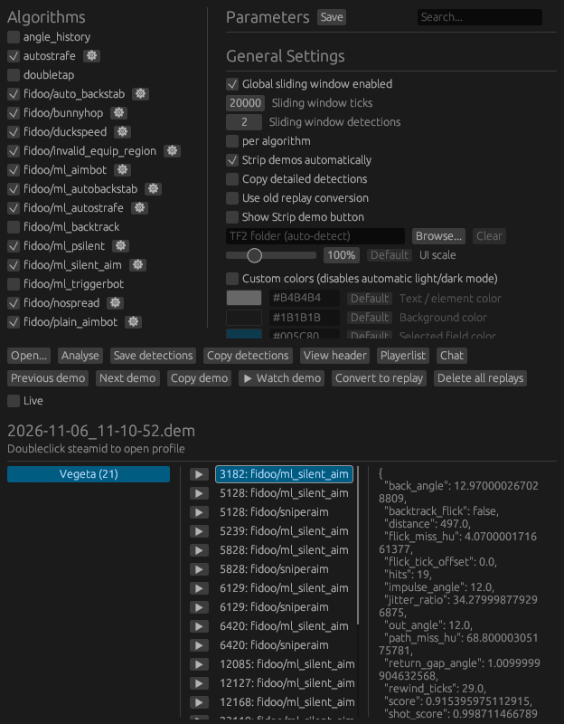

- **Algorithms** (top left) are the checks. Tick one to run it on the next scan. The gear button jumps to its settings.
- **Parameters** (top right) holds the settings: General Settings, RCON Settings for live scanning, TF2BD, then each check's own numbers. Type in **Search...** to find a setting, and click **Save** to keep your changes.
- **Results** (bottom) list the flagged players on the left. Click a player for their detections in the middle, written as `tick: check`. Click a detection to see what the check measured on the right.

| Button | What it does |
| --- | --- |
| Open... | Picks a demo file. Dragging a demo onto the window opens and scans it in one go. |
| Analyse | Scans the demo with the ticked checks. |
| Save detections | Saves the results as a file. |
| Copy detections | Copies a short summary ready to paste into Discord: each player, their count per check and the first ticks. With **Copy detailed detections** ticked in General Settings, it copies a .json file with every detection instead. |
| View header | Shows the demo's map, length, recorder and server. |
| Playerlist | Lists everyone in the demo by team. Double-click a player to inspect their events. |
| Chat | Shows the demo's chat. |
| Previous demo, Next demo | Opens the demo before or after this one in the same folder. |
| Copy demo | Copies the demo file itself, to paste into Discord or a folder. |
| ▶ Watch demo | Opens the whole demo in the 3D player. |
| Convert to replay | Puts the demo in TF2's replay folder, with a take for each suspect, to watch in TF2's own replay viewer. |
| Delete all replays | Deletes every .dmx and .dem file from TF2's replay folder. |
| Live | Watches the demo TF2 is recording and scans it while you play. With RCON set up, it can also warn in party chat. |

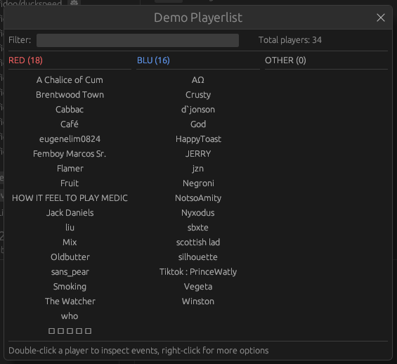

Right-click a flagged player for more: view them in the playerlist, copy their SteamHistory link, Steam profile link, SteamID or in-game name, or mark them in your TF2BD lists. Double-click a SteamID to open the Steam profile.

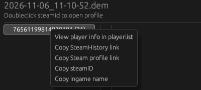

**Updates.** When a newer build is released, **Update available** shows next to Open... . Click it to download the new version, check it against its published checksum and restart. Your settings, reports and clips stay, and the version you had is kept next to it as `Demo Analysis (previous).exe`, in case you want to go back. New builds bring in Fidoo001's changes to the detection checks: a robot on the GitHub repository checks his project every day, and his changes are released once they pass the tests and are merged. Until then, **N upstream updates** next to Open... shows that he has changed something; click it to see what.

## The 3D player at a glance

The 3D player rebuilds the match from the demo and TF2's own files: the real map, class models, weapons, animations, projectiles and buildings. Cosmetics and hats are left out. The numbers on the picture match the list below it.

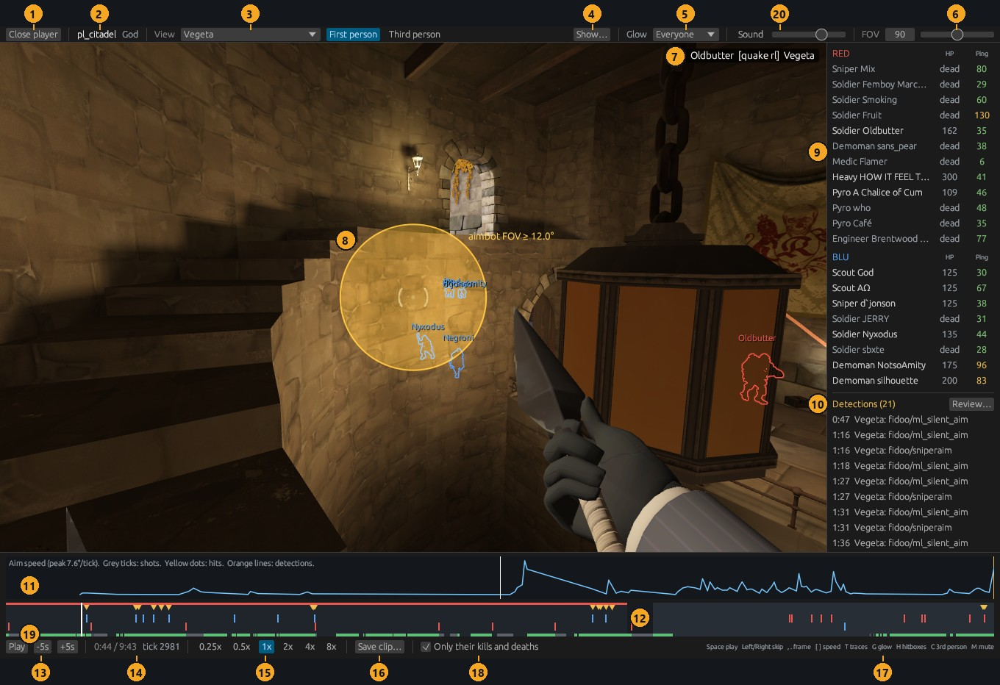

1. **Close player** goes back to the main window.
2. The map, and who recorded the demo.
3. **View** picks the player you watch, or the free camera. **First person** and **Third person** next to it choose between their eyes and a camera behind them.
4. **Show...** turns the overlays on and off. See [The Show menu](#the-show-menu).
5. **Glow** outlines players through walls: Everyone, Enemies, Teammates or Off.
6. **FOV** sets the field of view.
7. The kill feed: killer, [weapon], victim. Chat shows at the bottom left of the view, and who's talking on voice chat at the bottom right.
8. The aimbot FOV circle, when you watch a player with aim detections.
9. The player list: class, name, health (or dead) and scoreboard ping. Ping is green up to 80 ms, amber up to 150 and red above. Click a name to watch through their eyes; right-click for more.
10. Every detection in the scan. Click one to jump to 3 seconds before it. **Review...** starts review mode.
11. The aim graph: how fast the watched player's view turns. Grey ticks are shots, yellow dots are hits, orange lines are detections.
12. The timeline. Click or drag on it to jump. Each shaded band is a round, with a strip on top in the winning team's colour, and orange triangles are detections. Kills are ticks: red above the middle for kills by RED, blue below for kills by BLU. While you watch a player, it shows only their kills (above) and deaths (below) instead. Hover any mark to see what it is.
13. **Play** or **Pause**, and skip 5 seconds back or forward.
14. The time in the demo, and the tick.
15. Playback speed, from 0.25x to 8x.
16. **Save clip...** records a clip. See [Saving clips](#saving-clips).
17. A reminder of the keyboard shortcuts.
18. **Only their kills and deaths** keeps the timeline to the watched player's own fights. Untick it to see every kill in the match.
19. The tracked bar, when you watch a player: green while the demo has them alive, grey while it has them dead, and empty while they're out of the recorder's view. A demo recorded by a player only gets other players while they're near enough to matter to the recorder's game, so in the empty stretches they're frozen or missing. Jump to the green stretches to find their fights.
20. **Sound** sets the volume; click the word or press M to mute. See [Sound](#sound).

## Controls

Everything works with the mouse, and the keys below speed it up. Keys do nothing while you're typing in a text box.

| Key or mouse | What it does |
| --- | --- |
| Space | Play or pause |
| Left / Right arrow | Skip 5 seconds back or forward |
| Shift + Left / Right | Skip 30 seconds back or forward |
| `,` and `.` | Step one frame back or forward, and pause |
| `[` and `]` | Play slower or faster (0.25x to 8x) |
| T | Bullet lines and projectile trails on or off |
| G | Glow: Everyone, then Enemies, Teammates, Off |
| H | Hitboxes on or off |
| A | Aim lines on or off, when watching a player. In the free camera, A moves left. |
| M | Mute or unmute the sound |
| Esc | Leave review mode |
| Drag in the view (either button) | In third person, swing the camera around the player. Otherwise look around: from a player's eyes, this starts the free camera there. |
| Scroll in the view | Zoom the third-person camera in or out |
| Double-click in the view | Put the third-person camera back behind the player |
| C | Switch between first and third person |
| W, A, S, D | Move the free camera |
| Q / E | Move the free camera down / up |
| Hold Shift | Move the free camera 3 times faster |
| Click a name in the player list | Watch that player |
| Right-click a name | Player menu: review, report, TF2BD, Steam |
| Click or drag on the timeline | Jump to that moment |
| Click a detection in the list | Jump to 3 seconds before it |

## Cameras

You watch a player through their eyes or from behind them, or fly a free camera yourself. Pick a player or the free camera in the **View** menu at the top, and **First person** or **Third person** next to it.

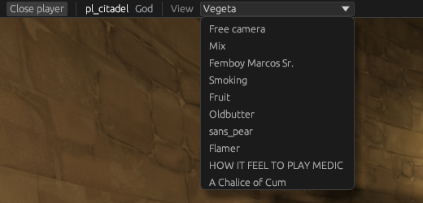

**Through a player's eyes.** Pick a name in View, click a name in the player list, or click a detection. You see what they saw: their hands and weapon firing, reloading and switching with TF2's own first-person animations, and TF2's crosshair. The view follows their real aim, so a flick shows exactly as it happened.

**Sniper scope.** When the watched Sniper zooms in, the view zooms and shows the scope, as in TF2. The aimbot FOV circle, if on, grows with the zoom.

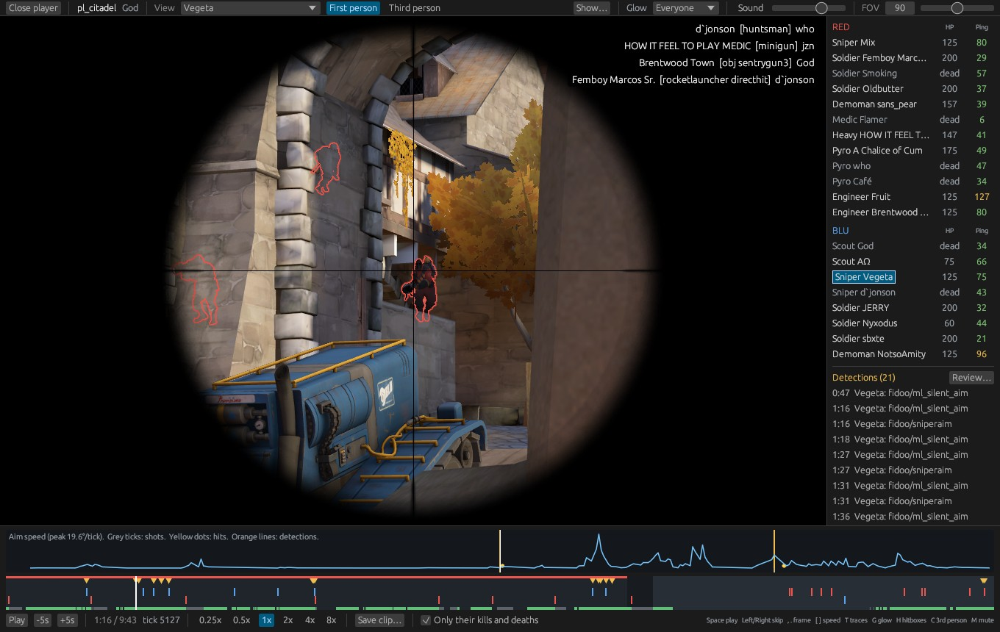

**Third person.** Pick **Third person**, or press C, to watch from behind the player instead of through their eyes. You see their body, weapon and animations as they move and aim. Drag in the view to swing the camera around them, like spectating; it keeps following them as they move. Scroll to zoom in or out, and double-click to put the camera back behind them. Their hands, crosshair and scope only show in first person.

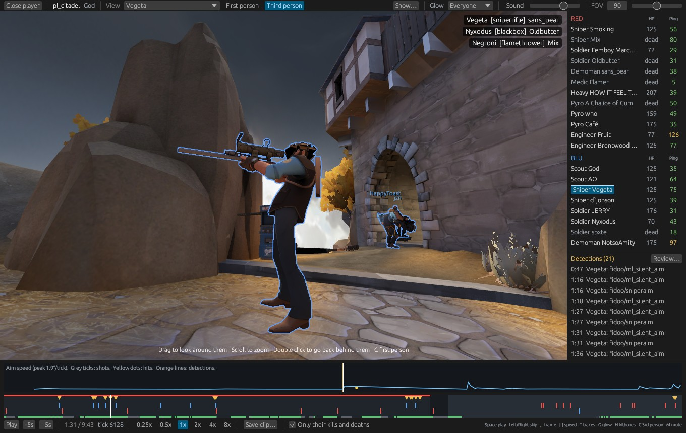

**Free camera.** Pick **Free camera** in View, or drag in the view. Drag to look, W A S D to move, Q and E to go down and up, and hold Shift to go faster. A hint line at the bottom of the view reminds you. Use it to see players from outside: their animations, ragdolls when they die, sentries turning to aim, and projectiles in flight.

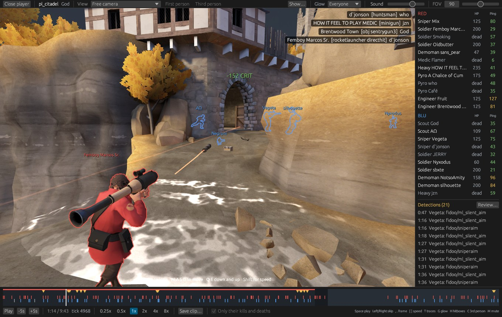

## The Show menu

**Show...** at the top draws what a check saw on top of the match. Each option is a tick box.

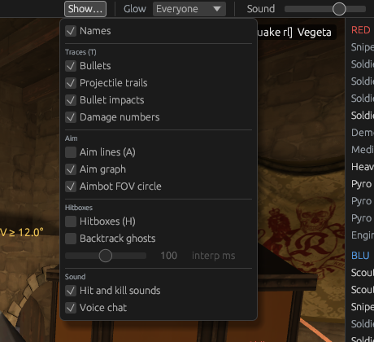

| Option | What it shows | Key | On at start |
| --- | --- | --- | --- |
| Names | Player names over their heads | | Yes |
| Bullets | A line for every hitscan shot, from the gun's muzzle to where it hit. A bullet that hit a player stops at them. | T | Yes |
| Projectile trails | Trails behind rockets, pipes, stickies, flares, arrows and other projectiles | T | Yes |
| Bullet impacts | A mark where each bullet hit | | Yes |
| Damage numbers | Damage over the player who took it. When watching someone, only their own hits. | | Yes |
| Aim lines | A line from every player's eyes to where they look, through walls too | A | No |
| Aim graph | How fast the watched player's view turns, above the timeline | | Yes |
| Aimbot FOV circle | For a player with aim detections, a circle around the crosshair as wide as their aimbot reaches | | Yes |
| Hitboxes | The boxes bullets are tested against. The head is yellow. | H | No |
| Backtrack ghosts | Where the server puts enemies when it judges the watched player's shots | | No |
| Hit and kill sounds | TF2's hit and kill sounds for the watched player's hits and kills | | Yes |
| Voice chat | Players talking on voice chat, at normal speed | | Yes |

**Aim lines and hitboxes** together show what a player was aiming at, and whether a shot that hit was really on target.

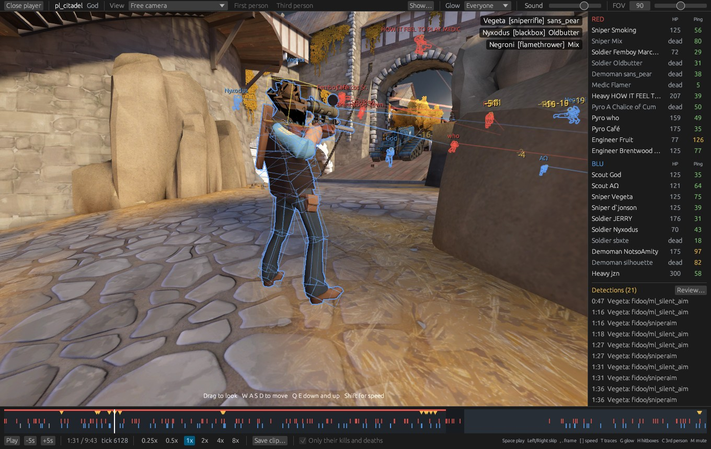

**Aim graph.** Human aim speeds up and slows down smoothly. An aimbot snap shows as one tall, thin spike, often right on an orange detection line.

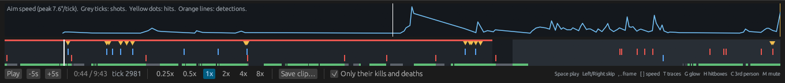

**Aimbot FOV circle.** It is worked out automatically each time a scanned demo opens in the 3D player. For every flagged player, it takes the biggest flick onto a target among their aim detections (silent aim, sniper aim and the aimbot checks). The circle is that angle from the crosshair, labelled "aimbot FOV ≥ X°". Their aimbot reaches at least that far, so treat it as a lower bound. It also shows in review mode and in player reports. Players with no aim detections get no circle.

**Backtrack ghosts.** When you watch a player, ghosts show where the server judged enemies to be for that player's shots: one round trip (their scoreboard ping plus 30 ms) plus their interpolation delay ago. Set the delay with the **interp ms** slider: 100 ms is TF2's default and 15 ms is common in competitive configs. A hit on a ghost far behind the real player is what backtrack cheats abuse.

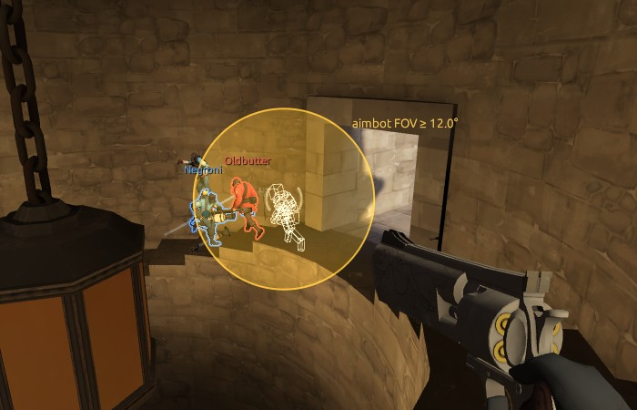

## Sound

The 3D player plays the match's sound from TF2's own sound files: guns, rockets, explosions, footsteps, voice lines like "Medic!", sentries, pickups and doors. Each sound comes from where it happened, so it gets quieter with distance and comes from the left or right of whoever you're watching.

- **Sound** in the top bar sets the volume. Click the word, or press M, to mute.
- Sound plays at up to 2x speed, and stops when you pause or jump. Voice chat only plays at 1x, so it stays in time.
- **Voice chat** from the demo plays too. Who's talking shows at the bottom right of the view, in their team's colour.
- **Hit and kill sounds:** when you watch a player, TF2's hit and kill sounds play for their hits and kills. Both can be turned off in **Show...**.

What you hear is what the recording player's game heard. A demo only has the sounds the server sent them, so sounds far from them are missing even when you watch someone else. Their own footsteps aren't in the demo at all; their own shots and swings are worked out from their first-person animation.

## Review mode

Review mode plays one player's detections one after another, so you can judge each one without hunting for it. Start it from **Review...** above the detections list, or right-click a player and pick **Review their detections**.

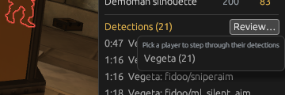

For each detection, the player:

1. Goes a little before the flagged moment and plays it in slow motion (0.25x) through the player's eyes, with aim lines and the aim graph on. A countdown says "Flagged in 1.0 s".
2. Pauses on the flagged moment.
3. Plays a little after it, so you see what happened next.

The bar over the view says which detection you're on ("detection 1 of 14"), which check fired, what to look for on screen, and what the check measured in plain words: angles, distances, ticks, scores and the target's name. Detections a moment apart are shown together.

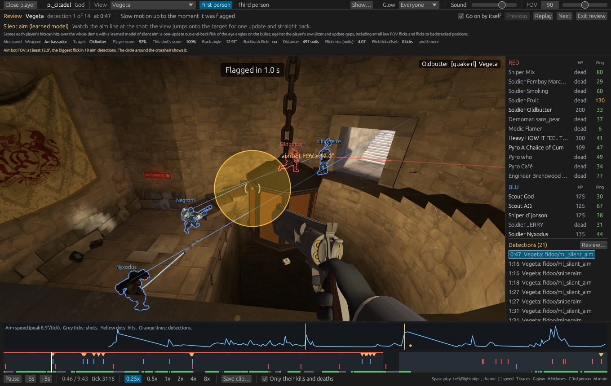

**Previous**, **Replay** and **Next** step between detections. Tick **Go on by itself** to move on automatically. **Exit review** or Esc ends it and puts your own settings back.

## Players, reports and TF2BD

Right-click a name in the 3D player's list for everything you can do with that player.

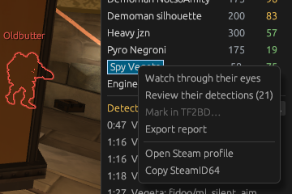

| Menu item | What it does |
| --- | --- |
| Watch through their eyes | Same as clicking the name |
| Review their detections (N) | Starts review mode for them. Greyed out when they have no detections. |
| Mark in TF2BD... | Opens the TF2BD mark dialog over the player. Needs TF2BD turned on in the main window. |
| Export report | Saves an HTML report and opens it in your browser |
| Open Steam profile | Opens their Steam profile in your browser |
| Copy SteamID64 | Copies their SteamID64 |

**Player reports** are one HTML page per player, saved in the `reports` folder next to the program. A report holds the player's SteamID64 and profile link, the demo, map and recorder, and the classes they played. It lists their detections by check and one by one with time and tick, their estimated aimbot FOV, and their match stats: kills, deaths, assists, headshot kills, backstabs, damage dealt and taken, and bullet accuracy. A ping chart ends the page. Send the file to an admin or post it with a report.

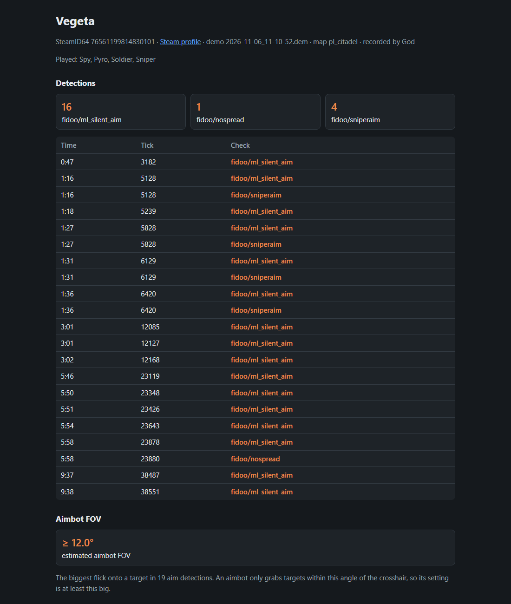

**TF2BD.** In the main window, open the TF2BD section of the settings and tick **Enable TF2BD features**. The TF2BD Community Biglist and TF2BD Trusted lists load by default; **Configure playerlists** adds or removes lists, and has buttons to add those two back. Players tagged in your lists show their tag next to their name in the 3D player, and you can mark players from either window.

## Saving clips

**Save clip...** in the bottom bar records the 3D view around where you are, half before and half after, with the overlays and glow you have on. Clips are silent: the sound isn't recorded.

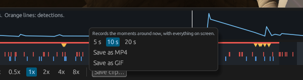

1. Go to the moment you want and set up the view and overlays.
2. Click **Save clip...** and pick 5, 10 or 20 seconds.
3. Click **Save as MP4** or **Save as GIF**. MP4 needs [ffmpeg](https://ffmpeg.org) installed; without it, only GIF is offered.
4. The bottom bar counts the frames as it records; **Cancel** stops it. When it's done, **Open folder** shows the file in the `clips` folder next to the program.

## Files, command line and troubleshooting

The program keeps everything next to itself, so the folder can be moved or deleted as a whole.

| File or folder | What it is |
| --- | --- |
| `params.json` | Your settings. Delete it to go back to the defaults. |
| `reported_ids.txt` | A public list of known cheaters, downloaded the first time it's needed. Delete it to download it again. |
| `reports\` | Player reports exported from the 3D player |
| `clips\` | Clips saved from the 3D player |

**Command line.** `demo-analysis-cli.exe` runs the same scan without a window. Run it in a terminal with `--help` to see its options.

**Troubleshooting**

| Problem | Fix |
| --- | --- |
| Windows "protected your PC" | Click **More info**, then **Run anyway**. The program isn't signed. |
| "Team Fortress 2 wasn't found" | Install TF2 through Steam. The 3D player finds it through Steam; it doesn't have to be running. |
| "The map ... isn't in your TF2 folder" | The demo is on a community map you don't have. Join a server running that map once in TF2 so it downloads, then try again. |
| No MP4 option when saving a clip | Install [ffmpeg](https://ffmpeg.org) so the program can find it, or save a GIF. |
| "Mark in TF2BD..." is greyed out | Tick **Enable TF2BD features** in the TF2BD settings of the main window. |
| No aimbot FOV circle | The watched player has no aim detections, or the circle is off in **Show...**. |
| "Update available" fails | The message says why; your current version keeps working. You can also download the zip from the [releases page](https://github.com/wombo14/tf2-demo-analyser/releases/latest). |
| No sound | Check that **Sound** isn't at zero or muted (M), and that you're playing at 2x or slower. "No sound device" in the top bar means Windows has no speakers or headphones to play to. |

**Credits and license.** Demo Analysis is by Fidoo001 and contributors ([tf2-demo-analyser on GitHub](https://github.com/Fidoo001/tf2-demo-analyser)) under the GNU GPL version 3. This version adds the built-in 3D player and the TF2BD community lists as defaults, and is shared under the same license with its full source in the `source` folder. `CHANGES.txt` lists every change, with dates.
